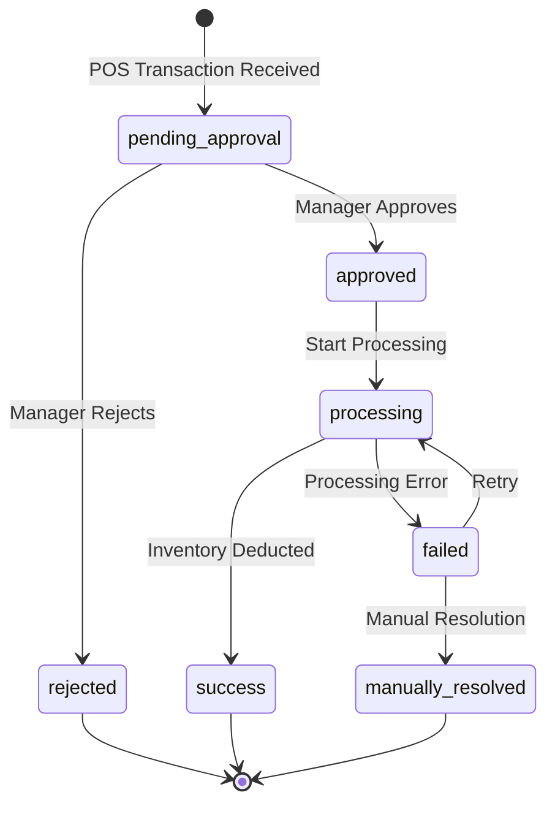
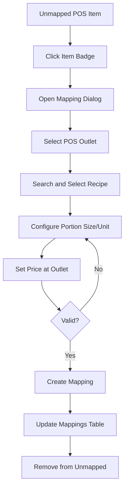
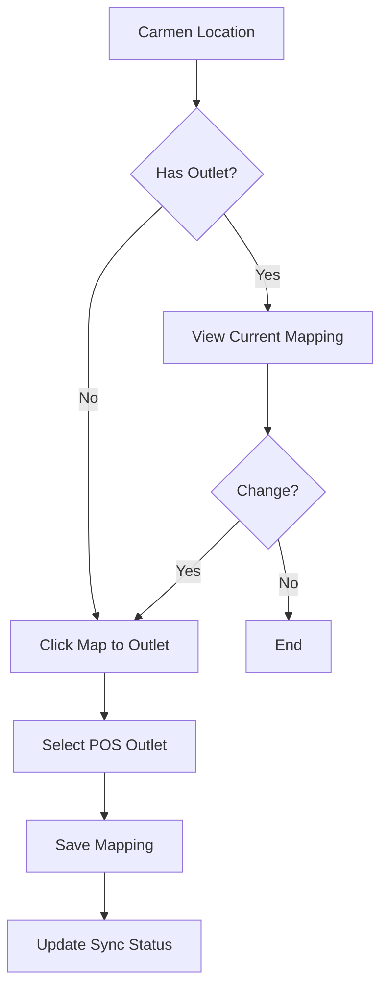
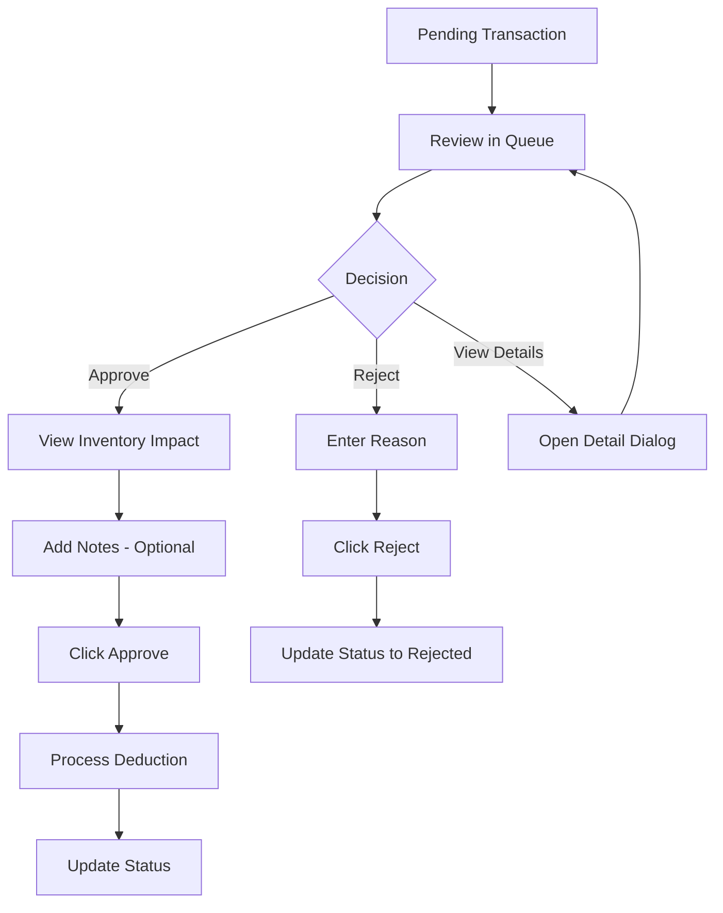
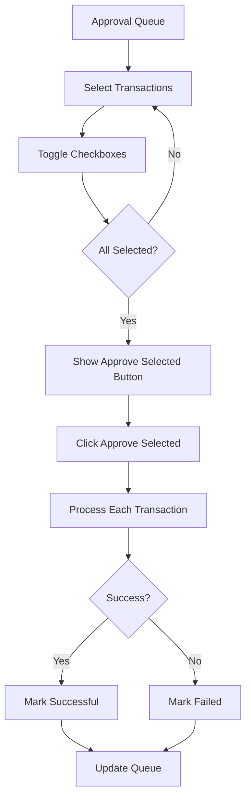
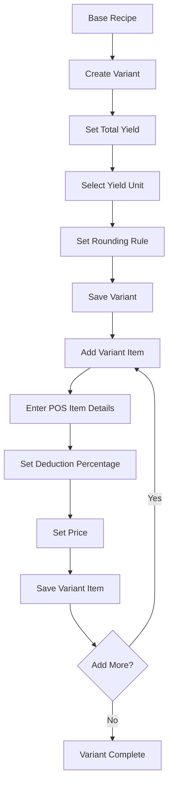
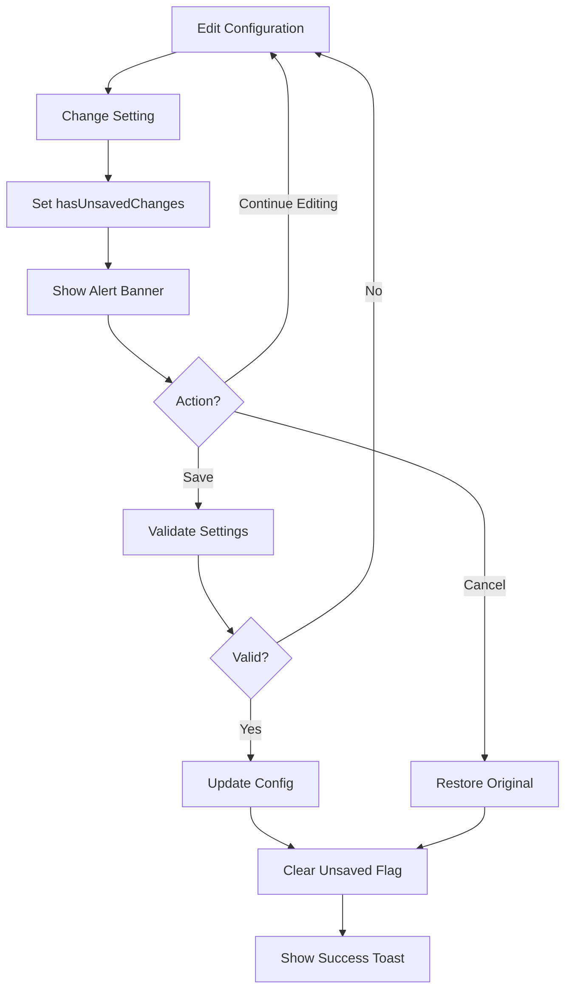
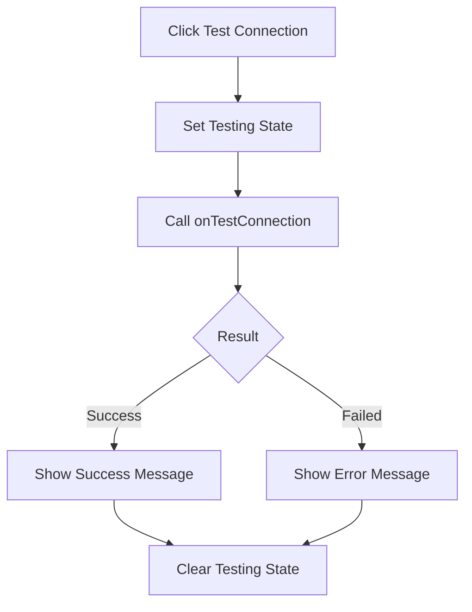
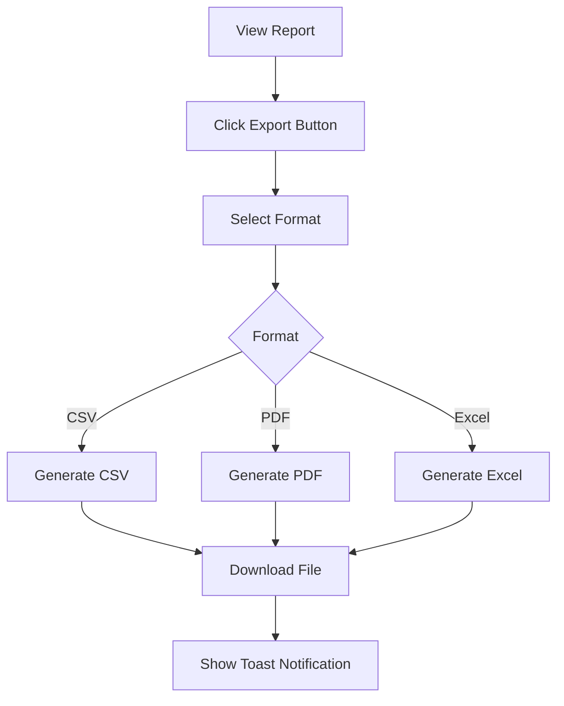
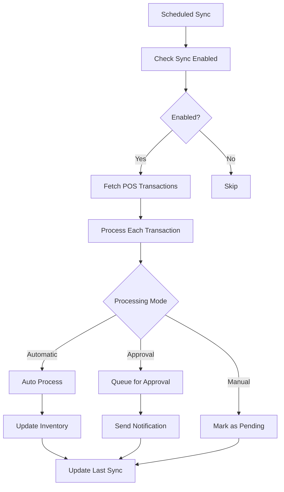

# Flow Diagrams: POS Integration

## Module Information
- **Module**: System Administration > System Integrations
- **Sub-Module**: POS Integration
- **Route**: `/system-administration/system-integration/pos`
- **Version**: 1.0.0
- **Last Updated**: 2026-01-18

---

## Transaction Processing Flow

---

## Recipe Mapping Flow

---

## Location Mapping Flow

---

## Transaction Approval Flow

---

## Bulk Approval Flow

---

## Fractional Variant Flow

---

## Configuration Save Flow

---

## Connection Test Flow

---

## Report Export Flow

---

## Sync Workflow

---

**Document End**
